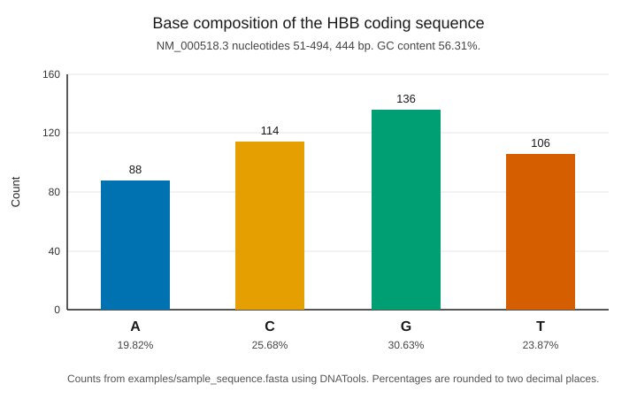

# Bioinformatics Core Toolkit

[](https://github.com/Ishitta-Sarkar/bioinformatics-core-toolkit/actions)
[](LICENSE)


Core DNA sequence operations, written from scratch in pure Python to learn the algorithms behind standard bioinformatics libraries. Production work should use [Biopython](https://biopython.org/).

## Question

What does each core DNA operation actually compute, and does a from-scratch implementation agree with Biopython on a public coding sequence?

The operations are GC content, transcription, reverse complement, translation with the standard genetic code, FASTA parsing, and ungapped substitution detection.

## Features (`src/dna_tools.py`, class `DNATools`)

| Method | What it does |
|---|---|
| `is_valid_dna()` | checks the sequence contains only A/C/G/T |
| `length()` | sequence length |
| `gc_content()` | GC percentage, rounded to two decimal places |
| `transcribe()` | DNA → mRNA (T → U) |
| `reverse_complement()` | reverse complement |
| `translate_to_protein()` | codon translation with the standard genetic code |
| `parse_fasta(path)` | reads a (multi-record) FASTA file into a `{header: sequence}` dict |
| `detect_mutations(ref, sample)` | 1-based substitutions on the shared prefix. Emits `LengthMismatchWarning` when the lengths differ. Does not call insertions or deletions |

## Methods

Spaces and newlines are removed and the sequence is uppercased before validation, GC content, transcription, reverse complement, and translation. `detect_mutations` only uppercases; it does not remove whitespace.

- **Validation.** Every remaining character must be A, C, G, or T. An empty string is treated as valid. `N` and U are not.
- **GC content.** `(count(G) + count(C)) / length × 100`, then Python's `round` to two decimal places (banker's rounding). An empty sequence returns `0`. Bases that are not G or C stay in the length, so an `N` lowers the percentage without adding to the GC count.
- **Transcription.** `T` is replaced by `U`. The strand is not reversed. Invalid DNA returns the text `Invalid DNA sequence` instead of raising.
- **Reverse complement.** The sequence is reversed and bases are swapped, A↔T and G↔C.
- **Translation.** Codons are read from the first base in steps of three, using NCBI translation table 1 (the standard genetic code, written with T). A trailing incomplete codon is dropped. Stop codons are `*`, and translation continues through them. There is no open-reading-frame search and the sequence does not have to start with ATG.
- **FASTA.** Each header, without the leading `>`, maps to its sequence lines joined together. Case is kept. If a header is repeated, the last record is kept. Lines before the first header are ignored. A line that starts with `;` is stored as sequence, not as a comment. Files are read as UTF-8.
- **Substitutions.** Both strings are uppercased and compared position by position up to the shorter length. Positions are 1-based. A length difference raises `LengthMismatchWarning` and is not turned into an insertion or a deletion. The same length does not prove that indels are absent: a deletion in one place and an insertion in another still looks like a run of substitutions.

## Quick start

Requires Python 3.10 or newer. The toolkit has no runtime dependencies. Biopython is installed only for the tests.

```bash
git clone https://github.com/Ishitta-Sarkar/bioinformatics-core-toolkit.git
cd bioinformatics-core-toolkit
python -m pip install -r requirements.txt   # nothing to install; documents the runtime
python main.py                              # demo on examples/sample_sequence.fasta
python -m pip install -r requirements-dev.txt
pytest -q                                   # tests, compared with Biopython 1.88
```

`pip install -e ".[dev]"` installs the same package and the same pinned test tools.

```python
from src.dna_tools import DNATools

# Synthetic 18 bp example. This is not the HBB record in examples/.
seq = DNATools("ATGTTTAAAGGGCCCTAG")
seq.gc_content()            # 44.44
seq.translate_to_protein()  # 'MFKGP*'
```

`44.44` is `(4 + 4) / 18 × 100`, rounded to two decimal places. The translation is `ATG TTT AAA GGG CCC TAG` → `M F K G P *`.

## Example data

`examples/sample_sequence.fasta` is the coding sequence of human hemoglobin subunit beta.

| Item | Value |
|---|---|
| Record | NCBI RefSeq [NM_000518.3](https://www.ncbi.nlm.nih.gov/nuccore/NM_000518.3) |
| Definition | Homo sapiens hemoglobin, beta (HBB), mRNA |
| Interval | nucleotides 51–494 (1-based, end included), the GenBank `CDS` feature |
| Product | beta globin, [NP_000509.1](https://www.ncbi.nlm.nih.gov/protein/NP_000509.1) |
| Gene | NCBI Gene [3043](https://www.ncbi.nlm.nih.gov/gene/3043) |
| Accessed | 24 November 2026 |

The GenBank file was downloaded with NCBI E-utilities (`efetch.fcgi?db=nuccore&id=NM_000518.3&rettype=gb&retmode=text`). The bases in `ORIGIN` for positions 51–494 were uppercased and wrapped at 60 columns. They were not otherwise edited. The CDS is 444 bp and ends with the stop codon `TAA`.

The 18 bp string in the quick-start snippet is synthetic. It is covered by `tests/test_dna_tools.py` and it is not hemoglobin.

## Results

Computed by `DNATools` on `examples/sample_sequence.fasta` (24 November 2026):

| Quantity | Result |
|---|---|
| Length | 444 bp |
| Valid DNA | yes |
| A, C, G, T | 88, 114, 136, 106 |
| GC content | 56.31% |
| RNA, first 60 nt | `AUGGUGCACCUGACUCCUGAGGAGAAGUCUGCCGUUACUGCCCUGUGGGGCAAGGUGAAC` |
| Translation | NP_000509.1 (147 amino acids) followed by `*` |

GC content is `(136 + 114) / 444 × 100 = 56.3063…`, which rounds to 56.31. The translation is the protein string stored on NM_000518.3, plus the terminal stop that `translate_to_protein` keeps:

```text
MVHLTPEEKSAVTALWGKVNVDEVGGEALGRLLVVYPWTQRFFESFGDLSTPDAVMGNPKVKAHGKKVLGAFSDGLAHLDNLKGTFATLSELHCDKLHVDPENFRLLGNVLVCVLAHHFGKEFTPPVQAAYQKVVAGVANALAHKYH*
```

On this record, and on the synthetic sequences in the test suite, GC content (after the same rounding), transcription, reverse complement, and translation match Biopython 1.88. FASTA parsing matches `Bio.SeqIO` when headers are unique. The comparisons are in `tests/test_biopython_crosscheck.py`.



The figure is written by `examples/make_base_composition_figure.py` from the FASTA file. Percentages on the bars are `count / 444 × 100`, rounded to two decimal places. Regenerate it with:

```bash
python examples/make_base_composition_figure.py
```

`python main.py` prints the same summary, then a constructed substitution and a length mismatch. The edited base is not a reported HBB variant.

```text
Bioinformatics Core Toolkit
===================================
Record: NM_000518.3:51-494 Homo sapiens hemoglobin, beta (HBB) CDS | product beta globin | protein NP_000509.1 | NCBI GeneID:3043 | accessed 2026-11-24
Length: 444
Valid DNA: True
GC content: 56.31 %
RNA transcript (first 60 nt): AUGGUGCACCUGACUCCUGAGGAGAAGUCUGCCGUUACUGCCCUGUGGGGCAAGGUGAAC
Protein translation: MVHLTPEEKSAVTALWGKVNVDEVGGEALGRLLVVYPWTQRFFESFGDLSTPDAVMGNPKVKAHGKKVLGAFSDGLAHLDNLKGTFATLSELHCDKLHVDPENFRLLGNVLVCVLAHHFGKEFTPPVQAAYQKVVAGVANALAHKYH*
Protein length including stop: 148
Matches NP_000509.1 plus terminal stop: True

Constructed substitution (not a biological variant)
-----------------------------------
Reference: ATGGTGCACCTG
Sample:    ATGGTGAACCTG
Position: 7 | Reference: C | Sample: A

Length mismatch (substitutions on the shared prefix only)
-----------------------------------
Reference length: 12
Sample length: 11
Warning: Reference length (12) and sample length (11) differ. detect_mutations reports substitutions on the shared prefix only and does not call insertions or deletions.
Position: 7 | Reference: C | Sample: A
```

The reference in that demo is the first 12 bp of the CDS (`ATG GTG CAC CTG`, peptide `MVHL`). The sample changes codon 3 from `CAC` (H) to `AAC` (N) only so the printer has a substitution to show.

## Limitations

- One genetic code (NCBI table 1). No alternative codes, no six-frame translation, and no ORF finder.
- Ambiguous bases are rejected by `is_valid_dna`, `transcribe`, `reverse_complement`, and `translate_to_protein`. `gc_content` still runs and counts them in the length.
- `detect_mutations` does not align. It cannot report an insertion or a deletion, and a pair of sequences with the same length can hide one of each.
- The FASTA reader is a teaching parser. It does not support comment lines, quality scores, or wrapped header lines.
- Invalid DNA returns a sentence from some methods instead of raising. Call `is_valid_dna` before treating a return value as a sequence.
- This is a learning implementation. Production analysis should use Biopython, and variant calling should use an aligner.

## Roadmap

- [ ] Ambiguous bases (N and the other IUPAC DNA symbols). Lowercase input is already accepted and uppercased.
- [x] Warn when `detect_mutations` sees different lengths. Indels are still not called.
- [ ] Alignment-based mutation calling
- [ ] Six-frame translation and ORF finding
- [ ] Simple global alignment (Needleman–Wunsch)
- [x] Unit tests that cross-check against Biopython

## Tests

GitHub Actions (`.github/workflows/ci.yml`) installs `requirements.txt` and `requirements-dev.txt`, lints with Ruff 0.17.6, and runs pytest on Python 3.10, 3.11, and 3.12.

```bash
python -m pip install -r requirements-dev.txt
ruff check .
ruff format --check .
pytest -q
```

## Citation

Sarkar, I. (2026). *Bioinformatics Core Toolkit* (version 0.1.0). https://github.com/Ishitta-Sarkar/bioinformatics-core-toolkit

Reference-manager metadata is in [CITATION.cff](CITATION.cff). The change history is in [CHANGELOG.md](CHANGELOG.md).

## Author

Ishitta Sarkar · [ORCID](https://orcid.org/0009-0008-1028-6010) · [MIT License](LICENSE)

M.Tech in Bioinformatics (in progress, expected 2028). B.Tech Biotechnology (Honours), Dr. A.P.J. Abdul Kalam Technical University, 2022-2026.

## Repository layout

```text
src/dna_tools.py
main.py
examples/sample_sequence.fasta
examples/hbb_cds_base_composition.svg
examples/make_base_composition_figure.py
tests/
pyproject.toml
requirements.txt
requirements-dev.txt
.github/workflows/ci.yml
CITATION.cff
CHANGELOG.md
LICENSE
```
