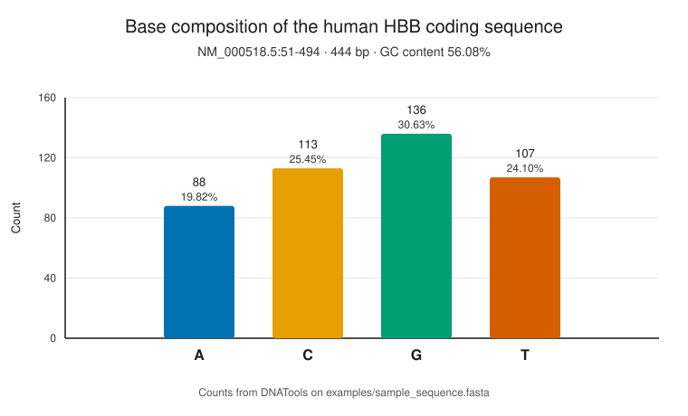

# Bioinformatics Core Toolkit

[](https://github.com/Ishitta-Sarkar/bioinformatics-core-toolkit/actions)
[](LICENSE)


Core DNA sequence operations, written from scratch in pure Python to learn the algorithms behind standard bioinformatics libraries. Production work should use [Biopython](https://biopython.org/).

## Question

What does each elementary DNA operation return, and does this implementation agree with Biopython on a real coding sequence?

The operations are GC content, transcription, reverse complement, translation with the standard genetic code, FASTA parsing, and a position-wise substitution scan. The real sequence is the coding sequence of human hemoglobin subunit beta.

## Features (`src/dna_tools.py`, class `DNATools`)

| Method | What it does |
|---|---|
| `is_valid_dna()` | checks the sequence contains only A/C/G/T |
| `length()` | sequence length |
| `gc_content()` | GC percentage, rounded to two decimal places |
| `transcribe()` | DNA → mRNA (T → U) |
| `reverse_complement()` | reverse complement |
| `translate_to_protein()` | codon translation with the standard genetic code |
| `parse_fasta(path)` | reads a (multi-record) FASTA file into a `{header: sequence}` dict |
| `detect_mutations(ref, sample)` | 1-based substitutions on the shared prefix. A length difference warns and appends the unmatched suffix. Internal indels are not aligned |

The distribution name is `bioinformatics-core-toolkit`. The import path used by the demo and the tests is `src.dna_tools`.

## Methods

`DNATools` uppercases its sequence and removes whitespace. `detect_mutations` cleans both arguments the same way.

- **Validation.** Every remaining character is A, C, G, or T. An empty sequence is valid and has length 0.
- **GC content.** `100 * (count(G) + count(C)) / length`, rounded with Python's `round` (ties to even). An empty sequence returns `0`. Any other character adds to the length and is not counted as GC.
- **Transcription.** T is replaced by U.
- **Reverse complement.** The sequence is reversed and A-T / C-G are swapped.
- **Translation.** Non-overlapping codons are read from the first base with NCBI translation table 1. Stop codons are `*`. A codon absent from the table would be `X`. A trailing incomplete codon is omitted.
- **FASTA.** The header is the text after `>`. Sequence lines are concatenated. A repeated header keeps the later sequence. Text before the first header is ignored.
- **Substitutions.** Bases are compared from the 5' end over the shared prefix. Positions are 1-based. Each substitution is `{"position", "reference", "sample"}` with single-character alleles. When the lengths differ, `LengthDifferenceWarning` is issued and one extra record holds the unmatched suffix: the shorter side is an empty string, and `position` is the first unmatched base. The scan does not insert gaps, so an internal indel shifts every following base into a substitution.

`transcribe`, `reverse_complement`, and `translate_to_protein` return the string `"Invalid DNA sequence"` when the cleaned sequence contains a character other than A, C, G, or T.

## Quick start

```bash
git clone https://github.com/Ishitta-Sarkar/bioinformatics-core-toolkit.git
cd bioinformatics-core-toolkit
python -m pip install -r requirements.txt -r requirements-dev.txt
python -m pip install -e .
python main.py                      # runs the demo on examples/sample_sequence.fasta
pytest -q                           # tests (compare results against Biopython)
```

`requirements.txt` lists no runtime dependencies. `requirements-dev.txt` pins pytest 9.2.0, Biopython 1.88, and Ruff 0.17.6. `python main.py` uses only the standard library and can be run from the clone before the install. `pip install -e .` is what makes `import src.dna_tools` work from any directory.

```python
from src.dna_tools import DNATools
seq = DNATools("ATGTTTAAAGGGCCCTAG")
seq.gc_content()            # 44.44
seq.translate_to_protein()  # 'MFKGP*'
```

That 18 bp string is a synthetic example. It is not the FASTA record below. Its reverse complement is `CTAGGGCCCTTTAAACAT`. The same three values are returned by Biopython 1.88 (`Bio.SeqUtils.gc_fraction` rounded to two decimals, `Seq.translate`, and `Seq.reverse_complement`).

## Example data

`examples/sample_sequence.fasta` is the coding sequence of *Homo sapiens* hemoglobin subunit beta (HBB):

| Field | Value |
|---|---|
| Accession | [NM_000518.5](https://www.ncbi.nlm.nih.gov/nuccore/NM_000518.5) |
| Coordinates | CDS 51–494 of the mRNA (444 bp, including the terminal stop `TAA`) |
| Protein | [NP_000509.1](https://www.ncbi.nlm.nih.gov/protein/NP_000509.1) |
| CCDS | [CCDS7753.1](https://www.ncbi.nlm.nih.gov/CCDS/CcdsBrowse.cgi?REQUEST=CCDS&DATA=CCDS7753) |
| Gene | HBB, NCBI GeneID [3043](https://www.ncbi.nlm.nih.gov/gene/3043), chromosome 11p15.4 |
| Retrieved | 24 November 2026, NCBI E-utilities `rettype=fasta_cds_na` |

NM_000518.5 is the RefSeq MANE Select transcript for HBB. The committed file was written by `scripts/fetch_hbb_cds.py`, which checks that the downloaded header contains `NM_000518.5`, `NP_000509.1`, and `location=51..494` before replacing the example. Run `python scripts/fetch_hbb_cds.py` to download it again. The download needs network access to `eutils.ncbi.nlm.nih.gov`.

## Results

`python main.py` reads the FASTA record and prints the summary below. These figures are the values returned by `DNATools` for that record.

| Measure | Result |
|---|---|
| Length | 444 bp |
| Valid DNA | True |
| CDS start | `ATGGTGCATCTG` |
| GC content | 56.08% (249 of 444 bases) |
| A | 88 (19.82%) |
| C | 113 (25.45%) |
| G | 136 (30.63%) |
| T | 107 (24.10%) |
| Translation | the 147 residues of NP_000509.1, then `*` for the terminal TAA |



*Figure 1. Base counts for NM_000518.5:51-494. GC content is 56.08%. The figure is written by `scripts/plot_base_composition.py` from the same FASTA file.*

On this CDS, Biopython 1.88 agrees with the toolkit on transcription, reverse complement, translation (including the terminal `*`), and GC content after rounding to two decimals. The same agreement holds for all 64 codons. The comparison is `tests/test_biopython_crosscheck.py`.

The demo then scans two synthetic pairs.

- `ATGCGTACCGTAGCTAGC` versus `ATGAGTACCGTGGCTAGC` (equal length): position 4, `C` to `A`; position 12, `A` to `G`.
- `ACGTACGT` versus `ACGTA`: the shared prefix matches, and the unmatched reference suffix is reported at position 6 as `'CGT' -> ''`. That call also emits `LengthDifferenceWarning` (reference 8 bp, sample 5 bp).

Stdout from `python main.py`:

```text
Bioinformatics Core Toolkit
============================================================
Record: NM_000518.5:51-494 Homo sapiens hemoglobin subunit beta (HBB) coding sequence | protein NP_000509.1 | CCDS7753.1 | https://www.ncbi.nlm.nih.gov/nuccore/NM_000518.5 | retrieved 2026-11-24
Length: 444 bp
Valid DNA: True
CDS start: ATGGTGCATCTG
GC content: 56.08%
A: 88 (19.82%)
C: 113 (25.45%)
G: 136 (30.63%)
T: 107 (24.10%)
Protein: MVHLTPEEKSAVTALWGKVNVDEVGGEALGRLLVVYPWTQRFFESFGDLSTPDAVMGNPKVKAHGKKVLGAFSDGLAHLDNLKGTFATLSELHCDKLHVDPENFRLLGNVLVCVLAHHFGKEFTPPVQAAYQKVVAGVANALAHKYH*
Transcript (first 60 nt): AUGGUGCAUCUGACUCCUGAGGAGAAGUCUGCCGUUACUGCCCUGUGGGGCAAGGUGAAC
Reverse complement (first 60 nt): TTAGTGATACTTGTGGGCCAGGGCATTAGCCACACCAGCCACCACTTTCTGATAGGCAGC

Substitution scan on a synthetic equal-length pair
------------------------------------------------------------
Reference: ATGCGTACCGTAGCTAGC
Sample:    ATGAGTACCGTGGCTAGC
Position 4: 'C' -> 'A'
Position 12: 'A' -> 'G'

Length difference on a synthetic pair
------------------------------------------------------------
Reference: ACGTACGT
Sample:    ACGTA
Position 6: 'CGT' -> ''
```

## Limitations

- A character other than A, C, G, or T makes `transcribe`, `reverse_complement`, and `translate_to_protein` return `"Invalid DNA sequence"`. `gc_content` still returns a percentage for that string.
- Translation reads frame 1 only. A trailing incomplete codon is omitted. For `ATGTT`, the toolkit returns `M`. Biopython 1.88 returns `M` as well and emits `BiopythonWarning`.
- `detect_mutations` does not insert gaps. An internal indel is reported as substitutions along the shifted prefix, plus a suffix record when the lengths differ.
- A repeated FASTA header keeps the later sequence.
- An empty string is valid DNA of length 0, and its GC content is 0.

## Roadmap

- [x] Unit tests that cross-check against Biopython
- [x] Report a length mismatch from `detect_mutations`
- [ ] IUPAC ambiguous bases, including N
- [ ] Six-frame translation and ORF finding
- [ ] Simple global alignment (Needleman–Wunsch), so an internal indel is reported as a gap

## Tests

```bash
pytest -q
```

`tests/test_dna_tools.py` covers the operations, the FASTA parser, the HBB record, and length differences. `tests/test_biopython_crosscheck.py` compares the toolkit with Biopython 1.88. `tests/test_main_and_figure.py` checks the demo output and that `docs/hbb_base_composition.svg` matches a fresh render of the FASTA file.

GitHub Actions (`.github/workflows/ci.yml`) installs `requirements.txt`, `requirements-dev.txt`, and the editable package, then runs Ruff and pytest on Python 3.10, 3.11, 3.12, and 3.13.

## Repository layout

```text
src/dna_tools.py                 DNATools
main.py                          demo on the HBB coding sequence
examples/sample_sequence.fasta   NM_000518.5:51-494
scripts/fetch_hbb_cds.py         re-download that CDS
scripts/plot_base_composition.py write the base-composition figure
docs/hbb_base_composition.svg    Figure 1
tests/                           pytest suite
pyproject.toml                   pip install -e .
requirements.txt                 no runtime dependencies
requirements-dev.txt             pytest, Biopython, Ruff
.github/workflows/ci.yml         lint and tests
CITATION.cff                     citation metadata
CHANGELOG.md                     release notes
LICENSE                          MIT
```

## Citation

Sarkar, I. (2026). *Bioinformatics Core Toolkit* (version 0.2.0). https://github.com/Ishitta-Sarkar/bioinformatics-core-toolkit

Machine-readable metadata is in [CITATION.cff](CITATION.cff).

## Author

Ishitta Sarkar · [ORCID 0009-0008-1028-6010](https://orcid.org/0009-0008-1028-6010)

M.Tech in Bioinformatics (in progress, expected 2028). B.Tech Biotechnology (Honours), Dr. A.P.J. Abdul Kalam Technical University, 2022–2026.

## License

MIT. See [LICENSE](LICENSE).
